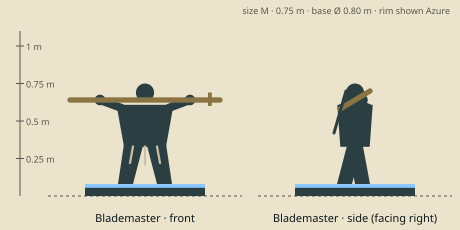

# Blademaster — model brief

**Fighter** · HP 14 · ATK 3 · RNG 1 · ARM 1 · SPD 3 (GDD v1.0 §10.3) · size class **M** · status: **spec**

Prefab `PF_Hero_Blademaster` · mesh `SK_Hero_Blademaster.fbx` · folder `unity/Assets/Art/Heroes/Blademaster/` · Addressables `hero/blademaster`

**Silhouette in one line:** A stocky grey-braided fencing master carrying a very long two-hand sword across her shoulders, wrists draped over it.

*Sketch: proportions and prop placement only (dark = figure, brown = prop, light = key light-value area, orange = emissive). Not a design drawing.*

## Proportions
Height 0.75 m (M). Stocky, low centre of gravity, forearms +30 %. Sword 1.0 m long: it overhangs the base by 0.10 m each side (allowed max 0.15).
Heroic style (STYLE §2): head about 1/6 of height, hands and weapon +25 %. Pivot at the base bottom centre, facing −Y in Blender (PIPELINE §3). Nothing may overhang the base more than 0.15 m sideways.

## Pose for the miniature (the `idle` key pose)
Mid-stride, relaxed and confident: sword across the back of the shoulders, both wrists hooked over it; chin up.

## Costume and materials
Quilted gambeson, single steel pauldron on the left, leather bracers, knee boots; belt hung with short coloured ribbons (each a won duel). Bare head, one long grey braid.

## Prop
Long two-hand sword (1.0 m, straight double edge, wide crossguard), worn across both shoulders.

## Color callouts (painted albedo; STYLE §3)
| Area | Color |
|---|---|
| Gambeson mustard | `#a8893f` |
| Olive trousers / straps | `#4b5236` |
| Blade steel | `#c9ced2` |
| Grey hair | `#b9b4ab` |
| Team mask: belt ribbons + sword-grip wrap | Azure `#8cc8ff` / Ember `#c4402a` via mask B |

## What must read at 3 cm (default 55° camera, phone screen)
1. Horizontal sword across the shoulders
2. Braid
3. Ribbons at the belt

## Must NOT resemble
No mask or face covering, no samurai armour, no katana, no tribal/grass skirt, no tornado spin pose. She is an old-world fencing teacher.

## Ability VFX notes (STYLE §8; condition tokens per §8.2)
| Key | Ability | VFX |
|---|---|---|
| Q | Blade Spin | One pale-steel circular slash ring at waist height around her (radius 1), steel sparks on each hit; wave hit pops up to 3 minions. |
| W | Battle Cry | Short shout rings, ribbons flare upward; +1 ATK icon flicks above her; a quick 1-hex step. |
| E | Decisive Strike | Straight thrust with a steel streak; a wax Silence seal slams onto the target. |
| R | Omnislash | She vanishes in a steel streak, 5 after-image slashes cross the target's hex, she lands adjacent (close-up camera). |

## Budget, rig, animation
- Tris: LOD0 12,000 · LOD1 6,000 · LOD2 2,500 (incl. base). Mobile/web uses LOD1 as top LOD.
- Textures: one set `T_Hero_Blademaster_A/_N/_M` (+`_E` if emissive) 2048 desktop / 1024 mobile; team mask in `_M` blue.
- Rig: `RIG_Mini_Biped` — Standard biped; sword on prop bone R, IK to hand L.
- Clips (PIPELINE §8.1): idle, move, attack, cast_q, cast_w, cast_e, cast_r, hit, stunned, ko, victory (+ optional idle_break, selected).
- Sockets: `socket_weapon_r/l`, `socket_cast`, `socket_head`, `socket_chest`, `socket_base`, `socket_token_0..5`.
