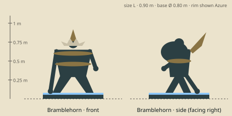

# Bramblehorn — model brief

**Initiator** · HP 15 · ATK 2 · RNG 1 · ARM 2 · SPD 3 (GDD v1.0 §10.3) · size class **L** · status: **spec**

Prefab `PF_Hero_Bramblehorn` · mesh `SK_Hero_Bramblehorn.fbx` · folder `unity/Assets/Art/Heroes/Bramblehorn/` · Addressables `hero/bramblehorn`

**Silhouette in one line:** A hulking, hunched bipedal beast with bark-like hide bound in iron bands, a single huge forward horn grown through a crown of brambles.

*Sketch: proportions and prop placement only (dark = figure, brown = prop, light = key light-value area, orange = emissive). Not a design drawing.*

## Proportions
Height 0.90 m (L) to the horn tip, back hump at 0.75 m. Huge shoulders and forearms, short legs, small eyes; horn 0.30 m long.
Heroic style (STYLE §2): head about 1/6 of height, hands and weapon +25 %. Pivot at the base bottom centre, facing −Y in Blender (PIPELINE §3). Nothing may overhang the base more than 0.15 m sideways.

## Pose for the miniature (the `idle` key pose)
Head lowered, horn forward as if about to toss; one fist on the base (knuckle-stance), the other arm swept back.

## Costume and materials
Bark-plated hide with moss on the back, three riveted iron bands round the chest and arms, bramble vines with thorns wound round the horn base and neck, a cloth tied to the horn.

## Prop
His horn (natural weapon); iron bands and a thorny bramble collar; a cloth banner tied round the horn.

## Color callouts (painted albedo; STYLE §3)
| Area | Color |
|---|---|
| Bark hide | `#5a4a36` |
| Moss | `#6d8a3c` |
| Iron bands | `#5e6266` |
| Horn ivory | `#d8cdb0` |
| Team mask: cloth tied round the horn | Azure `#8cc8ff` / Ember `#c4402a` via mask B |

## What must read at 3 cm (default 55° camera, phone screen)
1. Single big horn
2. Knuckle stance (hunched)
3. Thorny bramble collar

## Must NOT resemble
No rhino in sci-fi armour or with a gun, no armadillo, no bull or minotaur, no tree-person. He is a thorn-forest beast that walks upright.

## Ability VFX notes (STYLE §8; condition tokens per §8.2)
| Key | Ability | VFX |
|---|---|---|
| Q | Horn Toss | Upward toss: target flips back 1 hex (knockback arrow), bark splinters; Stun token. |
| W | Thick Hide | Bark plates grow over him (brown shell dome = Shield 3). |
| E | War Bellow | Free: a moss-green pulse rolls to radius 2, allies get a leafy Shield 2 glow. |
| R | Earthshaker | Brambles erupt across radius 2 and drag every enemy hero toward the centre (chain-like vine pull arrows), then roots grip them (Root square tokens, not stun); wave hit pops 3. |

## Budget, rig, animation
- Tris: LOD0 12,000 · LOD1 6,000 · LOD2 2,500 (incl. base). Mobile/web uses LOD1 as top LOD.
- Textures: one set `T_Hero_Bramblehorn_A/_N/_M` (+`_E` if emissive) 2048 desktop / 1024 mobile; team mask in `_M` blue.
- Rig: `RIG_Mini_Biped` — Biped + head/neck extra bone + horn bone; hunched rest pose.
- Clips (PIPELINE §8.1): idle, move, attack, cast_q, cast_w, cast_e, cast_r, hit, stunned, ko, victory (+ optional idle_break, selected).
- Sockets: `socket_weapon_r/l`, `socket_cast`, `socket_head`, `socket_chest`, `socket_base`, `socket_token_0..5`.
