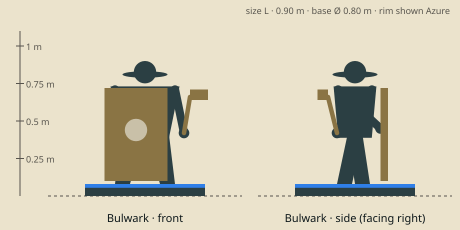

# Bulwark — model brief

**Tank** · HP 16 · ATK 2 · RNG 1 · ARM 2 · SPD 3 (GDD v1.0 §10.3) · size class **L** · status: **spec**

Prefab `PF_Hero_Bulwark` · mesh `SK_Hero_Bulwark.fbx` · folder `unity/Assets/Art/Heroes/Bulwark/` · Addressables `hero/bulwark`

**Silhouette in one line:** A walking door: a squat armoured figure behind a tall riveted pavise with a polished mirror boss, under a deep-brimmed kettle helm.

*Sketch: proportions and prop placement only (dark = figure, brown = prop, light = key light-value area, orange = emissive). Not a design drawing.*

## Proportions
Height 0.90 m (L). Very broad: shoulders 0.46 m wide, short thick legs (35 % of height), head 1/7 of height half-hidden by the helm brim. Pavise 0.62 × 0.42 m.
Heroic style (STYLE §2): head about 1/6 of height, hands and weapon +25 %. Pivot at the base bottom centre, facing −Y in Blender (PIPELINE §3). Nothing may overhang the base more than 0.15 m sideways.

## Pose for the miniature (the `idle` key pose)
Braced stance, left foot forward; pavise planted on the front edge of the base, held by the left arm; hammer cocked at the right hip. Looks over the pavise.

## Costume and materials
Layered pewter plates over an oxblood padded coat; mail skirt; heavy boots. Kettle helm with a wide brim and a nasal bar. Pavise: wood core, iron rim with big round rivets, mirror boss in the centre (Solar Flare comes from it).

## Prop
Tall pavise (0.62 m) with a round mirror boss; short square-headed warhammer.

## Color callouts (painted albedo; STYLE §3)
| Area | Color |
|---|---|
| Pewter steel (armour, pavise rim) | `#8c9196` |
| Oxblood leather / coat | `#5a2a22` |
| Pavise wood | `#6b5136` |
| Mirror boss (near white-gold, slight emissive 0.2) | `#f4ead0` |
| Team mask: pennant hanging from the pavise top + helm plume | Azure `#8cc8ff` / Ember `#c4402a` via mask B |

## What must read at 3 cm (default 55° camera, phone screen)
1. Pavise shape (a tall rectangle in front of the mini)
2. Bright mirror boss
3. Helm brim hiding the eyes

## Must NOT resemble
No sun-disc or sun-ray motifs, no gold-plated armour, no lion heads, no full-face golden helm, no glowing sword. He is a soldier with a door-like shield, not a radiant champion.

## Ability VFX notes (STYLE §8; condition tokens per §8.2)
| Key | Ability | VFX |
|---|---|---|
| Q | Shield Bash | Pavise shove: steel spark burst + short shockwave arc on the adjacent hex; Stun star token drops. |
| W | Iron Stance | Rivets flash in sequence, a brass hex-plate dome closes over him (Shield 4 token). |
| E | Charge | Ground-scrape streak along the dash line, dust wall at the stop, Slow hourglass on the target; wave hit pops 1 minion. |
| R | Solar Flare | He tilts the mirror boss toward the table lamp: a white-gold glare cone lands on the target hex + 6 neighbours, a flash ring, then Stun tokens (close-up camera). |

## Budget, rig, animation
- Tris: LOD0 12,000 · LOD1 6,000 · LOD2 2,500 (incl. base). Mobile/web uses LOD1 as top LOD.
- Textures: one set `T_Hero_Bulwark_A/_N/_M` (+`_E` if emissive) 2048 desktop / 1024 mobile; team mask in `_M` blue.
- Rig: `RIG_Mini_Biped` — Standard biped; pavise on prop bone L.
- Clips (PIPELINE §8.1): idle, move, attack, cast_q, cast_w, cast_e, cast_r, hit, stunned, ko, victory (+ optional idle_break, selected).
- Sockets: `socket_weapon_r/l`, `socket_cast`, `socket_head`, `socket_chest`, `socket_base`, `socket_token_0..5`.
