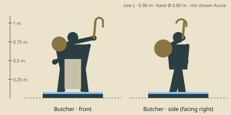

# Butcher — model brief

**Tank** · HP 16 · ATK 2 · RNG 1 · ARM 1 · SPD 3 (GDD v1.0 §10.3) · size class **L** · status: **spec**

Prefab `PF_Hero_Butcher` · mesh `SK_Hero_Butcher.fbx` · folder `unity/Assets/Art/Heroes/Butcher/` · Addressables `hero/butcher`

**Silhouette in one line:** A barrel-chested salt-marsh butcher with a hand-cranked winch on his back and a long iron harpoon-hook raised on a chain.

*Sketch: proportions and prop placement only (dark = figure, brown = prop, light = key light-value area, orange = emissive). Not a design drawing.*

## Proportions
Height 0.90 m (L). Barrel torso 0.48 m wide, short legs in waders, small head (1/7) with a broad walrus moustache. Hook rises to 1.05 m.
Heroic style (STYLE §2): head about 1/6 of height, hands and weapon +25 %. Pivot at the base bottom centre, facing −Y in Blender (PIPELINE §3). Nothing may overhang the base more than 0.15 m sideways.

## Pose for the miniature (the `idle` key pose)
Feet wide, leaning forward; right arm raises the hook overhead ready to throw, left hand on the winch crank at his hip; chain sags between them.

## Costume and materials
Oilskin smock, rolled sleeves on heavy forearms, rubber-look waders, long pale apron with brown stains (paint, not gore), flat cap. Winch: wooden drum with iron bands on a back frame.

## Prop
Iron harpoon-hook on a chain that runs to a back-mounted hand winch; filleting knife on the belt.

## Color callouts (painted albedo; STYLE §3)
| Area | Color |
|---|---|
| Tar-black oilskin | `#2a2a26` |
| Rust iron (hook, chain, winch bands) | `#8a4b2a` |
| Salt-stained apron | `#c9c0a8` |
| Weathered skin | `#c79a7a` |
| Team mask: neckerchief + winch-handle wrap | Azure `#2F7FE8` / Ember `#F5A030` via mask B |

## What must read at 3 cm (default 55° camera, phone screen)
1. Hook raised above the head
2. Winch drum silhouette behind the shoulders
3. Apron (light vertical block on a dark body)

## Must NOT resemble
No undead, stitched or rotting flesh, no exposed organs, no green or grey corpse skin, no obese abomination body, no meat cleaver in hand. He is a living, tough dock worker with fishing gear.

## Ability VFX notes (STYLE §8; condition tokens per §8.2)
| Key | Ability | VFX |
|---|---|---|
| Q | Meat Hook | Chain-link trail along the line (rust sparks), the hook clamps the first hero, chain snaps taut, target slides adjacent along a chain-link pull arrow. |
| W | Rot | Murky brown-green marsh gas ring around his feet (radius 1), bubbles; he takes 1 (small self-damage pop). |
| E | Devour | He scoops 2 minions; they spiral into his apron as paint flakes; green heal motes. |
| R | Dismember | Winch spins, chain wraps the target, Stun token drops; a dark red-brown drain stream flows back to him (heal half). |

## Budget, rig, animation
- Tris: LOD0 12,000 · LOD1 6,000 · LOD2 2,500 (incl. base). Mobile/web uses LOD1 as top LOD.
- Textures: one set `T_Hero_Butcher_A/_N/_M` (+`_E` if emissive) 2048 desktop / 1024 mobile; team mask in `_M` blue.
- Rig: `RIG_Mini_Biped` — Biped + 6 chain bones from hand R to the winch; winch drum rotates on 1 bone.
- Clips (PIPELINE §8.1): idle, move, attack, cast_q, cast_w, cast_e, cast_r, hit, stunned, ko, victory (+ optional idle_break, selected).
- Sockets: `socket_weapon_r/l`, `socket_cast`, `socket_head`, `socket_chest`, `socket_base`, `socket_token_0..5`.
