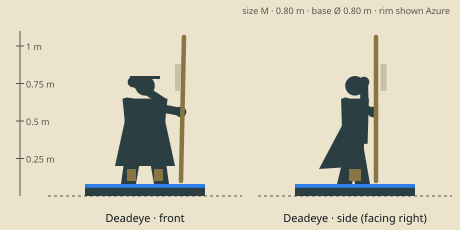

# Deadeye — model brief

**Marksman** · HP 9 · ATK 2 · RNG 4 · ARM 0 · SPD 3 (GDD v1.0 §10.3) · size class **M** · status: **spec**

Prefab `PF_Hero_Deadeye` · mesh `SK_Hero_Deadeye.fbx` · folder `unity/Assets/Art/Heroes/Deadeye/` · Addressables `hero/deadeye`

**Silhouette in one line:** A tall, thin sharpshooter in a long duster, a long-barrelled rifle with a brass spyglass scope standing almost as tall as she is, powder charges strapped to her boots.

*Sketch: proportions and prop placement only (dark = figure, brown = prop, light = key light-value area, orange = emissive). Not a design drawing.*

## Proportions
Height 0.80 m (M, slim): narrowest shoulders of the M heroes (0.30 m), long legs; rifle 1.0 m.
Heroic style (STYLE §2): head about 1/6 of height, hands and weapon +25 %. Pivot at the base bottom centre, facing −Y in Blender (PIPELINE §3). Nothing may overhang the base more than 0.15 m sideways.

## Pose for the miniature (the `idle` key pose)
Standing tall, rifle held vertically at her side with the butt on the base, other hand raising the flip-down lens visor; duster swept back by the wind.

## Costume and materials
Long dust-tan duster with shoulder cape, waistcoat, fingerless gloves, flat-topped cap with a brass lens visor flipped over one eye, tall boots each strapped with two powder canisters.

## Prop
Long-barrelled rifle (1.0 m) with a brass spyglass scope and a bipod; powder-charge canisters on both boots (Rocket Jump).

## Color callouts (painted albedo; STYLE §3)
| Area | Color |
|---|---|
| Dust-tan duster | `#9c8466` |
| Gunmetal barrel | `#4a4e52` |
| Walnut stock | `#5a3a24` |
| Brass scope / visor | `#d6a748` |
| Team mask: armband + cap band | Azure `#8cc8ff` / Ember `#c4402a` via mask B |

## What must read at 3 cm (default 55° camera, phone screen)
1. Tall vertical rifle
2. Scope glint
3. Duster hem flare

## Must NOT resemble
No small creature with an oversized cannon, no cowboy hat, no sci-fi rifle or laser sights, no mechanical arm. She is a long-gun hunter.

## Ability VFX notes (STYLE §8; condition tokens per §8.2)
| Key | Ability | VFX |
|---|---|---|
| Q | Piercing Shot | Muzzle smoke ring, a tracer line through every enemy on the 5-hex line; wave hit pops 2. |
| W | Snare Trap | A thrown iron snare clamps the target's feet (Root square token), chain to a stake. |
| E | Rocket Jump | Free: powder bursts at her boots, smoke column, dashed jump arc, landing puff. |
| R | Headshot | A scope glint sight-line crosses up to 7 hexes, then a sharp crack and recoil smoke; armour reduction shown like an Attack (cracked-shield icon). |

## Budget, rig, animation
- Tris: LOD0 12,000 · LOD1 6,000 · LOD2 2,500 (incl. base). Mobile/web uses LOD1 as top LOD.
- Textures: one set `T_Hero_Deadeye_A/_N/_M` (+`_E` if emissive) 2048 desktop / 1024 mobile; team mask in `_M` blue.
- Rig: `RIG_Mini_Biped` — Standard biped; rifle on prop bone R, duster 3 bones.
- Clips (PIPELINE §8.1): idle, move, attack, cast_q, cast_w, cast_e, cast_r, hit, stunned, ko, victory (+ optional idle_break, selected).
- Sockets: `socket_weapon_r/l`, `socket_cast`, `socket_head`, `socket_chest`, `socket_base`, `socket_token_0..5`.
