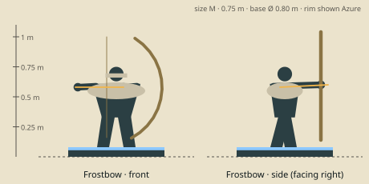

# Frostbow — model brief

**Marksman** · HP 10 · ATK 2 · RNG 3 · ARM 0 · SPD 3 (GDD v1.0 §10.3) · size class **M** · status: **spec**

Prefab `PF_Hero_Frostbow` · mesh `SK_Hero_Frostbow.fbx` · folder `unity/Assets/Art/Heroes/Frostbow/` · Addressables `hero/frostbow`

**Silhouette in one line:** A fur-mantled glacier guide drawing a bow taller than herself, made of pale spiral horn, with crampons on her boots.

*Sketch: proportions and prop placement only (dark = figure, brown = prop, light = key light-value area, orange = emissive). Not a design drawing.*

## Proportions
Height 0.75 m (M). Bulky from the fur mantle (0.45 m wide at the shoulders) over slim legs; bow 1.0 m.
Heroic style (STYLE §2): head about 1/6 of height, hands and weapon +25 %. Pivot at the base bottom centre, facing −Y in Blender (PIPELINE §3). Nothing may overhang the base more than 0.15 m sideways.

## Pose for the miniature (the `idle` key pose)
Bow drawn, aimed slightly up and to the side so the bow arc stands clear of the body from the front camera; weight on the back foot.

## Costume and materials
Quilted spruce-green coat, wide snow-white fur mantle, fur hat with earflaps tied under the chin, mittens with free trigger fingers, crampons strapped to boots, ice axe on the belt, crystal arrows in a hip quiver.

## Prop
Recurve bow of spiral horn (1.0 m tall); quiver of crystal arrows; ice axe at the hip.

## Color callouts (painted albedo; STYLE §3)
| Area | Color |
|---|---|
| Spruce coat | `#2f4a44` |
| Snow fur | `#e6e2d8` |
| Horn bow | `#d9cfae` |
| Crystal arrows (emissive 0.4) | `#bfeaf2` |
| Team mask: hat earflap ties + scarf | Azure `#2F7FE8` / Ember `#F5A030` via mask B |

## What must read at 3 cm (default 55° camera, phone screen)
1. Tall bow arc
2. Fur mantle (wide light shoulders)
3. Earflap hat

## Must NOT resemble
No hooded ice queen, no blue skin or ice-crystal body, no elf ears, no cape, no tiara. She is a mountain guide.

## Ability VFX notes (STYLE §8; condition tokens per §8.2)
| Key | Ability | VFX |
|---|---|---|
| Q | Volley | Three frosted arrows arc onto the target hex + neighbours, rime patches and Slow tokens; wave hit pops 3. |
| W | Frost Arrows | The bow ices over with cyan rime; her Attacks this activation leave frost puffs and Slow. |
| E | Tumble | A snow-spray roll along the path (passes through enemies). |
| R | Crystal Arrow | A long crystal shaft streaks the 6-hex line, shatters on the first hero into a crystal starburst; Stun token. |

## Budget, rig, animation
- Tris: LOD0 12,000 · LOD1 6,000 · LOD2 2,500 (incl. base). Mobile/web uses LOD1 as top LOD.
- Textures: one set `T_Hero_Frostbow_A/_N/_M` (+`_E` if emissive) 2048 desktop / 1024 mobile; team mask in `_M` blue.
- Rig: `RIG_Mini_Biped` — Biped + bowstring bone; arrow on prop bone R.
- Clips (PIPELINE §8.1): idle, move, attack, cast_q, cast_w, cast_e, cast_r, hit, stunned, ko, victory (+ optional idle_break, selected).
- Sockets: `socket_weapon_r/l`, `socket_cast`, `socket_head`, `socket_chest`, `socket_base`, `socket_token_0..5`.
