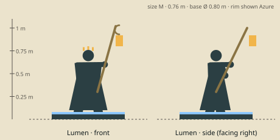

# Lumen — model brief

**Support** · HP 11 · ATK 1 · RNG 2 · ARM 0 · SPD 3 (GDD v1.0 §10.3) · size class **M** · status: **spec**

Prefab `PF_Hero_Lumen` · mesh `SK_Hero_Lumen.fbx` · folder `unity/Assets/Art/Heroes/Lumen/` · Addressables `hero/lumen`

**Silhouette in one line:** A robed lamplighter holding a tall hooked pole from which a glass lantern swings, a ring of small candles set in her hair.

*Sketch: proportions and prop placement only (dark = figure, brown = prop, light = key light-value area, orange = emissive). Not a design drawing.*

## Proportions
Height 0.76 m (M). Slender, robe widens to 0.40 m at the hem; pole top at 1.05 m, lantern at 0.85 m.
Heroic style (STYLE §2): head about 1/6 of height, hands and weapon +25 %. Pivot at the base bottom centre, facing −Y in Blender (PIPELINE §3). Nothing may overhang the base more than 0.15 m sideways.

## Pose for the miniature (the `idle` key pose)
Pole held forward and up in both hands so the lantern hangs in front, over the neighbouring hex edge; serene, head slightly bowed toward the light.

## Costume and materials
Layered cream robes, a long plum stole with embroidered flame shapes, rope belt with a satchel, soft shoes; hair in a bun ringed with 5 short candles (painted flames, emissive).

## Prop
Hooked lamplighter's pole (1.05 m) with a hanging glass lantern; a satchel of wicks.

## Color callouts (painted albedo; STYLE §3)
| Area | Color |
|---|---|
| Cream robes | `#e3d8bd` |
| Plum stole | `#4d2f45` |
| Brass lantern frame | `#d6a748` |
| Warm light (emissive 1.2) | `#ffe08a` |
| Team mask: stole tassels + lantern ribbon | Azure `#8cc8ff` / Ember `#c4402a` via mask B |

## What must read at 3 cm (default 55° camera, phone screen)
1. Hanging lantern on a hooked pole
2. Long robe triangle
3. Candle ring

## Must NOT resemble
No horns, no star/celestial animal features, no angel wings or halo, no nun habit. She is a town lamplighter who carries light to people.

## Ability VFX notes (STYLE §8; condition tokens per §8.2)
| Key | Ability | VFX |
|---|---|---|
| Q | Mend | Warm motes drift from the lantern to the ally, soft upward ring, green +3. |
| W | Binding Light | A beam along the 4-hex line; on the first enemy it becomes light ribbons binding the feet (Root square token); wave hit pops 1. |
| E | Barrier | Lantern-glass hex dome around the ally (Shield 3 token). |
| R | Wish | She lifts the lantern high; motes rise off the board and fall on every allied hero anywhere (heal 4), warm flash per hero. |

## Budget, rig, animation
- Tris: LOD0 12,000 · LOD1 6,000 · LOD2 2,500 (incl. base). Mobile/web uses LOD1 as top LOD.
- Textures: one set `T_Hero_Lumen_A/_N/_M` (+`_E` if emissive) 2048 desktop / 1024 mobile; team mask in `_M` blue.
- Rig: `RIG_Mini_Biped` — Standard biped; pole on prop bone R, lantern 1 swing bone.
- Clips (PIPELINE §8.1): idle, move, attack, cast_q, cast_w, cast_e, cast_r, hit, stunned, ko, victory (+ optional idle_break, selected).
- Sockets: `socket_weapon_r/l`, `socket_cast`, `socket_head`, `socket_chest`, `socket_base`, `socket_token_0..5`.
