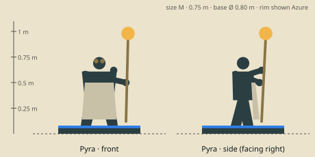

# Pyra — model brief

**Mage** · HP 10 · ATK 1 · RNG 2 · ARM 0 · SPD 3 (GDD v1.0 §10.3) · size class **M** · status: **spec**

Prefab `PF_Hero_Pyra` · mesh `SK_Hero_Pyra.fbx` · folder `unity/Assets/Art/Heroes/Pyra/` · Addressables `hero/pyra`

**Silhouette in one line:** A glassblower in a heavy leather apron holding a long blowpipe-staff tipped with a glowing bulb of molten glass, goggles pushed up on her brow.

*Sketch: proportions and prop placement only (dark = figure, brown = prop, light = key light-value area, orange = emissive). Not a design drawing.*

## Proportions
Height 0.75 m (M). Average build, strong forearms, long apron to the shins; staff tip at 1.0 m.
Heroic style (STYLE §2): head about 1/6 of height, hands and weapon +25 %. Pivot at the base bottom centre, facing −Y in Blender (PIPELINE §3). Nothing may overhang the base more than 0.15 m sideways.

## Pose for the miniature (the `idle` key pose)
Staff held upright in the right hand, bulb at head height and slightly forward; left hand cupped under it as if shaping the glass; head tilted toward it.

## Costume and materials
Heavy scorched leather apron over a soot-grey work dress, rolled sleeves, thick gloves, brass goggles on the brow, short hair tied in a headscarf, a row of small coloured glass beads on the apron strap.

## Prop
Iron blowpipe-staff (1.0 m) with a glowing molten glass bulb (Ø 0.12 m); shears on the belt.

## Color callouts (painted albedo; STYLE §3)
| Area | Color |
|---|---|
| Scorched leather apron | `#6b4a32` |
| Soot-grey dress | `#3a3836` |
| Molten glass (emissive 1.5) | `#ffb347` |
| Brass goggles | `#d6a748` |
| Team mask: headscarf | Azure `#8cc8ff` / Ember `#c4402a` via mask B |

## What must read at 3 cm (default 55° camera, phone screen)
1. Glowing bulb on the staff
2. Apron silhouette
3. Goggles on the brow

## Must NOT resemble
No little girl with a toy, no flaming hair or burning body, no fire-elemental skin, no dancer outfit. Her fire is molten glass from a craft.

## Ability VFX notes (STYLE §8; condition tokens per §8.2)
| Key | Ability | VFX |
|---|---|---|
| Q | Fireball | A glob of molten glass lobs onto the target hex and splashes over its neighbours, then cools into black glass shards; wave hit pops up to 3. |
| W | Flame Ring | A ring of glowing glass beads hardens around the target's ankles like a cage: reads as **Root** (square token), not stun. |
| E | Scorch | A short straight jet of molten sparks from the pipe to the target. |
| R | Pyroblast | She blows a big bulb (cheeks puff), it lobs and bursts with a heavy orange flash and glass rain (close-up camera). |

## Budget, rig, animation
- Tris: LOD0 12,000 · LOD1 6,000 · LOD2 2,500 (incl. base). Mobile/web uses LOD1 as top LOD.
- Textures: one set `T_Hero_Pyra_A/_N/_M` (+`_E` if emissive) 2048 desktop / 1024 mobile; team mask in `_M` blue.
- Rig: `RIG_Mini_Biped` — Standard biped; staff on prop bone R.
- Clips (PIPELINE §8.1): idle, move, attack, cast_q, cast_w, cast_e, cast_r, hit, stunned, ko, victory (+ optional idle_break, selected).
- Sockets: `socket_weapon_r/l`, `socket_cast`, `socket_head`, `socket_chest`, `socket_base`, `socket_token_0..5`.
