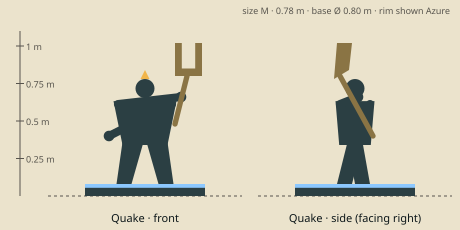

# Quake — model brief

**Initiator** · HP 13 · ATK 2 · RNG 1 · ARM 1 · SPD 3 (GDD v1.0 §10.3) · size class **M** · status: **spec**

Prefab `PF_Hero_Quake` · mesh `SK_Hero_Quake.fbx` · folder `unity/Assets/Art/Heroes/Quake/` · Addressables `hero/quake`

**Silhouette in one line:** A basalt-skinned quarry-wright resting a giant two-pronged stone tuning fork on his shoulder like a maul.

*Sketch: proportions and prop placement only (dark = figure, brown = prop, light = key light-value area, orange = emissive). Not a design drawing.*

## Proportions
Height 0.78 m (M). Blocky: square shoulders 0.42 m, short neck, thick arms; fork prongs rise 0.25 m above the head.
Heroic style (STYLE §2): head about 1/6 of height, hands and weapon +25 %. Pivot at the base bottom centre, facing −Y in Blender (PIPELINE §3). Nothing may overhang the base more than 0.15 m sideways.

## Pose for the miniature (the `idle` key pose)
Fork resting on the right shoulder, left fist clenched at his side, feet planted; ready to swing the fork down into the ground.

## Costume and materials
Leather work harness and apron with chisels, stone-dust-caked basalt skin with ochre cracks, wrapped shins, bare feet. A small ochre crystal cluster on the crown.

## Prop
Stone tuning-fork maul (0.80 m; two prongs, iron-bound handle); chisels on the harness.

## Color callouts (painted albedo; STYLE §3)
| Area | Color |
|---|---|
| Basalt skin | `#3d3b3a` |
| Ochre dust / cracks (emissive 0.2 on cracks) | `#b98a4a` |
| Fork stone | `#7d7a70` |
| Harness leather | `#5a3e28` |
| Team mask: belt cloth + handle wrap | Azure `#2F7FE8` / Ember `#F5A030` via mask B |

## What must read at 3 cm (default 55° camera, phone screen)
1. Two-pronged fork over the shoulder
2. Square stone shoulders
3. Crystal on the head

## Must NOT resemble
No bull, minotaur or horns, no totem pole, no tribal shaman costume, no rock-golem body. He is a person of living stone who works a quarry.

## Ability VFX notes (STYLE §8; condition tokens per §8.2)
| Key | Ability | VFX |
|---|---|---|
| Q | Fissure | Fork strikes the ground: a glowing ochre crack runs the 4-hex line, dust spouts, Stun tokens; wave hit pops 2. |
| W | Enchant Totem | The fork prongs hum: visible sound rings ripple off them; the next Attack shows a double-damage ×2 badge. |
| E | Tremor | Dust ring around his feet (radius 1), Slow tokens; wave hit pops 2. |
| R | Echo Slam | Fork slams down: concentric sound rings to radius 2; each enemy unit in range emits its own extra echo ring (shows the +1 each). |

## Budget, rig, animation
- Tris: LOD0 12,000 · LOD1 6,000 · LOD2 2,500 (incl. base). Mobile/web uses LOD1 as top LOD.
- Textures: one set `T_Hero_Quake_A/_N/_M` (+`_E` if emissive) 2048 desktop / 1024 mobile; team mask in `_M` blue.
- Rig: `RIG_Mini_Biped` — Standard biped; fork on prop bone R.
- Clips (PIPELINE §8.1): idle, move, attack, cast_q, cast_w, cast_e, cast_r, hit, stunned, ko, victory (+ optional idle_break, selected).
- Sockets: `socket_weapon_r/l`, `socket_cast`, `socket_head`, `socket_chest`, `socket_base`, `socket_token_0..5`.
