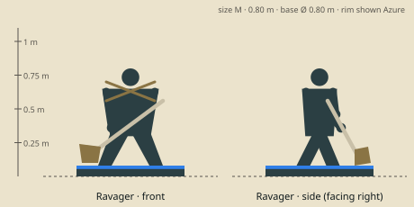

# Ravager — model brief

**Fighter** · HP 15 · ATK 2 · RNG 1 · ARM 1 · SPD 3 (GDD v1.0 §10.3) · size class **M** · status: **spec**

Prefab `PF_Hero_Ravager` · mesh `SK_Hero_Ravager.fbx` · folder `unity/Assets/Art/Heroes/Ravager/` · Addressables `hero/ravager`

**Silhouette in one line:** A broad woodcutter-berserker holding a double-bitted felling axe low across his body, logging chains looped over his shoulders.

*Sketch: proportions and prop placement only (dark = figure, brown = prop, light = key light-value area, orange = emissive). Not a design drawing.*

## Proportions
Height 0.80 m (M, top of the range). Broad back and long arms, forward-hunched; big hands; haft 0.75 m.
Heroic style (STYLE §2): head about 1/6 of height, hands and weapon +25 %. Pivot at the base bottom centre, facing −Y in Blender (PIPELINE §3). Nothing may overhang the base more than 0.15 m sideways.

## Pose for the miniature (the `idle` key pose)
Low crouch, weight on the front foot, axe held in both hands diagonally across the body with the head down by the right foot, ready to swing up.

## Costume and materials
Plaid wrap kilt and belted shirt with torn sleeves, bark-pattern tattoos on bare forearms, fur collar, hobnail boots, two loops of logging chain across the chest.

## Prop
Double-bitted felling axe on a long birch haft (0.75 m); logging chains.

## Color callouts (painted albedo; STYLE §3)
| Area | Color |
|---|---|
| Bottle-green plaid | `#2f4a35` |
| Plaid dark stripe | `#1d1d1a` |
| Birch haft | `#d8cfb8` |
| Axe iron | `#6d7072` |
| Team mask: rag tied on the haft + plaid thin stripe | Azure `#8cc8ff` / Ember `#c4402a` via mask B |

## What must read at 3 cm (default 55° camera, phone screen)
1. Diagonal axe across the body
2. Chains across the chest
3. Hunched, wide stance

## Must NOT resemble
No full plate armour, no noble cape or crest, no single-bit executioner axe held overhead, no horned helmet. He is a forest labourer, not a general.

## Ability VFX notes (STYLE §8; condition tokens per §8.2)
| Key | Ability | VFX |
|---|---|---|
| Q | Cleave | Wide arc of wood chips around him (radius 1); per enemy hero hit, a gold sap mote flies back to him (heal 2). |
| W | Hamstring | Low chop at the legs, a chain loop snaps round the ankle; Slow token with 2 pips. |
| E | Leap | High jump arc (dashed preview), landing crater of splinters and dust; Slow tokens on adjacent enemies. |
| R | Guillotine | Axe raised overhead, a dark-red blade shadow falls on the target; its length grows with the target's missing HP (shows the bonus). |

## Budget, rig, animation
- Tris: LOD0 12,000 · LOD1 6,000 · LOD2 2,500 (incl. base). Mobile/web uses LOD1 as top LOD.
- Textures: one set `T_Hero_Ravager_A/_N/_M` (+`_E` if emissive) 2048 desktop / 1024 mobile; team mask in `_M` blue.
- Rig: `RIG_Mini_Biped` — Standard biped; axe on prop bone R, IK hand L.
- Clips (PIPELINE §8.1): idle, move, attack, cast_q, cast_w, cast_e, cast_r, hit, stunned, ko, victory (+ optional idle_break, selected).
- Sockets: `socket_weapon_r/l`, `socket_cast`, `socket_head`, `socket_chest`, `socket_base`, `socket_token_0..5`.
