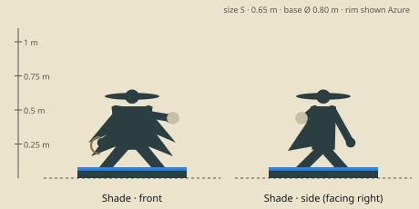

# Shade — model brief

**Assassin** · HP 10 · ATK 3 · RNG 1 · ARM 0 · SPD 4 (GDD v1.0 §10.3) · size class **S** · status: **spec**

Prefab `PF_Hero_Shade` · mesh `SK_Hero_Shade.fbx` · folder `unity/Assets/Art/Heroes/Shade/` · Addressables `hero/shade`

**Silhouette in one line:** A slight crouched figure in layered ash-grey shawls that fan out like folded moth wings, under a wide flat hat, a winged throwing disc in hand.

*Sketch: proportions and prop placement only (dark = figure, brown = prop, light = key light-value area, orange = emissive). Not a design drawing.*

## Proportions
Height 0.65 m (S) crouched (0.74 m if standing). Slim, long forearms; hat 0.40 m wide; shawl tips flare to 0.60 m wide.
Heroic style (STYLE §2): head about 1/6 of height, hands and weapon +25 %. Pivot at the base bottom centre, facing −Y in Blender (PIPELINE §3). Nothing may overhang the base more than 0.15 m sideways.

## Pose for the miniature (the `idle` key pose)
Low crouch on one knee-and-toe, body turned 3/4, disc hand drawn back to throw, knife hand forward and low.

## Costume and materials
Many thin layered shawls, grey outside with lilac lining showing at the edges (moth-wing pattern painted on), a soft veil across the lower face (eyes visible), wrapped legs, soft boots. Fuzzy pale collar like moth fur.

## Prop
Crescent sickle-knife (left hand); moth-wing throwing discs (one in the right hand, three on the belt).

## Color callouts (painted albedo; STYLE §3)
| Area | Color |
|---|---|
| Ash grey shawls | `#5a5752` |
| Dusk lilac lining | `#7a6c8a` |
| Pale moth-dust trim | `#e9e2cf` |
| Dark steel knife | `#4a4e52` |
| Team mask: hat band + sash | Azure `#2F7FE8` / Ember `#F5A030` via mask B |

## What must read at 3 cm (default 55° camera, phone screen)
1. Wide flat hat disc
2. Flaring shawl wing-points
3. Crouch (lowest hero head height)

## Must NOT resemble
No ninja hood-and-mask combo, no glowing eyes inside a hood, no kunai bandolier or katana, no catsuit. Her theme is a moth at dusk.

## Ability VFX notes (STYLE §8; condition tokens per §8.2)
| Key | Ability | VFX |
|---|---|---|
| Q | Shuriken | A spinning moth-wing disc flies the line trailing pale dust; wave hit pops 1 minion. |
| W | Shadow Step | Two smoke rings (start and landing) and a flutter of small moths; ignores walls (no line). |
| E | Smoke Veil | Mini turns to dithered smoky glass (Hidden), a few moths circle; crescent token on the rim. |
| R | Death Mark | A pale moth glyph lands on the target, crescent strike; on an execute the target's paint flakes away like dust. Reset: a moth lands on her hat and the 4th pip lights. |

## Budget, rig, animation
- Tris: LOD0 12,000 · LOD1 6,000 · LOD2 2,500 (incl. base). Mobile/web uses LOD1 as top LOD.
- Textures: one set `T_Hero_Shade_A/_N/_M` (+`_E` if emissive) 2048 desktop / 1024 mobile; team mask in `_M` blue.
- Rig: `RIG_Mini_Biped` — Standard biped + 4 shawl bones (wing tips sway in idle).
- Clips (PIPELINE §8.1): idle, move, attack, cast_q, cast_w, cast_e, cast_r, hit, stunned, ko, victory (+ optional idle_break, selected).
- Sockets: `socket_weapon_r/l`, `socket_cast`, `socket_head`, `socket_chest`, `socket_base`, `socket_token_0..5`.
