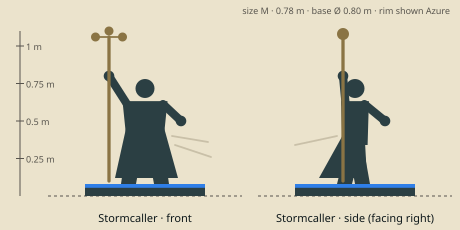

# Stormcaller — model brief

**Mage** · HP 10 · ATK 1 · RNG 2 · ARM 0 · SPD 3 (GDD v1.0 §10.3) · size class **M** · status: **spec**

Prefab `PF_Hero_Stormcaller` · mesh `SK_Hero_Stormcaller.fbx` · folder `unity/Assets/Art/Heroes/Stormcaller/` · Addressables `hero/stormcaller`

**Silhouette in one line:** A lanky old weather-watcher in a long storm coat trailing kite tails, raising a tall staff crowned with a spinning brass cup-anemometer.

*Sketch: proportions and prop placement only (dark = figure, brown = prop, light = key light-value area, orange = emissive). Not a design drawing.*

## Proportions
Height 0.78 m (M, lanky): long legs and neck, narrow shoulders, big hands; staff top at 1.10 m.
Heroic style (STYLE §2): head about 1/6 of height, hands and weapon +25 %. Pivot at the base bottom centre, facing −Y in Blender (PIPELINE §3). Nothing may overhang the base more than 0.15 m sideways.

## Pose for the miniature (the `idle` key pose)
Leaning into an invisible wind, coat and kite tails blown to one side, staff raised high in the left hand, right hand open toward the target.

## Costume and materials
Long oiled storm coat with ochre lining, many pockets with brass instruments, scarf, short beard, flat sailor cap; kite tails (paper bows on cord) tied to the coat back.

## Prop
Tall staff (1.1 m) topped with a 3-cup brass anemometer and a small weathervane arrow.

## Color callouts (painted albedo; STYLE §3)
| Area | Color |
|---|---|
| Storm-slate coat | `#3e4652` |
| Ochre lining | `#b08d3a` |
| Brass instruments | `#d6a748` |
| Lightning VFX accent | `#c9b6ff` |
| Team mask: kite-tail bows | Azure `#8cc8ff` / Ember `#c4402a` via mask B |

## What must read at 3 cm (default 55° camera, phone screen)
1. Anemometer cups at the top of the staff
2. Kite tails blown sideways
3. Lanky lean

## Must NOT resemble
No pointed wizard hat or long white beard and robe, no hammer-wielding storm god, no glowing storm-elemental body. He is an eccentric weather scientist.

## Ability VFX notes (STYLE §8; condition tokens per §8.2)
| Key | Ability | VFX |
|---|---|---|
| Q | Chain Lightning | Violet-white bolt from the anemometer to the first target, then numbered jumps (1, 2) to further enemies; wave hit pops 1. |
| W | Static Field | A crackling dome on the target hex + neighbours, wax Silence seals drop; wave hit pops 2. |
| E | Gust | A wind cone along the line; the first hero slides back 2 hexes on its base with a skid mark. |
| R | Thunderstorm | A small painted cloud on a clear acrylic rod rises over the radius-2 area and drops three bolts; flash, wave hit pops 3. |

## Budget, rig, animation
- Tris: LOD0 12,000 · LOD1 6,000 · LOD2 2,500 (incl. base). Mobile/web uses LOD1 as top LOD.
- Textures: one set `T_Hero_Stormcaller_A/_N/_M` (+`_E` if emissive) 2048 desktop / 1024 mobile; team mask in `_M` blue.
- Rig: `RIG_Mini_Biped` — Biped + 3 coat-tail bones + 2 kite-tail chains; anemometer spins on 1 bone.
- Clips (PIPELINE §8.1): idle, move, attack, cast_q, cast_w, cast_e, cast_r, hit, stunned, ko, victory (+ optional idle_break, selected).
- Sockets: `socket_weapon_r/l`, `socket_cast`, `socket_head`, `socket_chest`, `socket_base`, `socket_token_0..5`.
