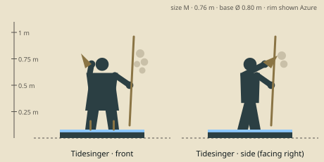

# Tidesinger — model brief

**Support** · HP 12 · ATK 1 · RNG 2 · ARM 0 · SPD 3 (GDD v1.0 §10.3) · size class **M** · status: **spec**

Prefab `PF_Hero_Tidesinger` · mesh `SK_Hero_Tidesinger.fbx` · folder `unity/Assets/Art/Heroes/Tidesinger/` · Addressables `hero/tidesinger`

**Silhouette in one line:** A tide-keeper on short wading stilts, blowing a large conch horn, with a staff hung with a net of glass fishing floats.

*Sketch: proportions and prop placement only (dark = figure, brown = prop, light = key light-value area, orange = emissive). Not a design drawing.*

## Proportions
Height 0.76 m (M) including 0.08 m stilt-sandals. Slim, long-legged; staff 0.95 m; floats Ø 0.06–0.09 m.
Heroic style (STYLE §2): head about 1/6 of height, hands and weapon +25 %. Pivot at the base bottom centre, facing −Y in Blender (PIPELINE §3). Nothing may overhang the base more than 0.15 m sideways.

## Pose for the miniature (the `idle` key pose)
Standing tall on the stilts, conch raised to her lips with the left hand, staff in the right hand leaning out so the float net hangs clear of the body.

## Costume and materials
Knee-length sand linen wrap with scalloped hem, sea-glass green shawl, coral-pink bead strings, rope sandals on short wooden stilts, hair wrapped in a cloth with small shells.

## Prop
Large conch horn (raised to the lips); wading staff with a net of 5 glass floats.

## Color callouts (painted albedo; STYLE §3)
| Area | Color |
|---|---|
| Sand linen | `#d8cba4` |
| Sea-glass green shawl | `#3f8a7e` |
| Coral beads | `#e08b7a` |
| Glass floats (translucent look, painted) | `#9fd3c7` |
| Team mask: head wrap + float-net cord | Azure `#8cc8ff` / Ember `#c4402a` via mask B |

## What must read at 3 cm (default 55° camera, phone screen)
1. Conch horn at the mouth
2. Glass float cluster
3. Stilts

## Must NOT resemble
No mermaid tail, no fish or amphibian person, no trident, no crown of coral. She is a shore-dweller who sings the tide.

## Ability VFX notes (STYLE §8; condition tokens per §8.2)
| Key | Ability | VFX |
|---|---|---|
| Q | Bubble | A big glass-float bubble encloses the target, it bobs; Stun token (only targeted ranged stun: big readable bubble). |
| W | Riptide | A water swirl round the ally washes its condition tokens off (they flick away), green +2. |
| E | Current | A streaming water arrow under the ally's feet (Haste token) and a thin shell shield (Shield 1). |
| R | Tidal Wave | A foaming ring wave rolls out to radius 2 around her: enemies get spray + Slow, allies get green heal motes; wave hit pops 2. |

## Budget, rig, animation
- Tris: LOD0 12,000 · LOD1 6,000 · LOD2 2,500 (incl. base). Mobile/web uses LOD1 as top LOD.
- Textures: one set `T_Hero_Tidesinger_A/_N/_M` (+`_E` if emissive) 2048 desktop / 1024 mobile; team mask in `_M` blue.
- Rig: `RIG_Mini_Biped` — Standard biped (feet on stilts = longer foot bones); float net 2 swing bones.
- Clips (PIPELINE §8.1): idle, move, attack, cast_q, cast_w, cast_e, cast_r, hit, stunned, ko, victory (+ optional idle_break, selected).
- Sockets: `socket_weapon_r/l`, `socket_cast`, `socket_head`, `socket_chest`, `socket_base`, `socket_token_0..5`.
