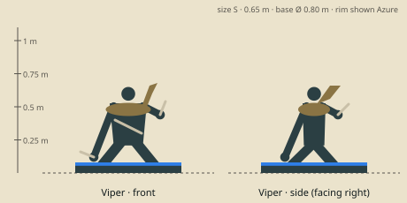

# Viper — model brief

**Assassin** · HP 10 · ATK 2 · RNG 1 · ARM 0 · SPD 4 (GDD v1.0 §10.3) · size class **S** · status: **spec**

Prefab `PF_Hero_Viper` · mesh `SK_Hero_Viper.fbx` · folder `unity/Assets/Art/Heroes/Viper/` · Addressables `hero/viper`

**Silhouette in one line:** A low-crouching poisoner with a live banded snake coiled round her shoulders like a scarf, two bone-fang daggers held backhand.

*Sketch: proportions and prop placement only (dark = figure, brown = prop, light = key light-value area, orange = emissive). Not a design drawing.*

## Proportions
Height 0.65 m (S). Wiry, long limbs, low crouch; snake body 1.2 m long coiled twice round the shoulders, head 0.12 m above hers.
Heroic style (STYLE §2): head about 1/6 of height, hands and weapon +25 %. Pivot at the base bottom centre, facing −Y in Blender (PIPELINE §3). Nothing may overhang the base more than 0.15 m sideways.

## Pose for the miniature (the `idle` key pose)
Crouched, one hand on the ground for balance (dagger pointing back), the other dagger hand raised; the snake rears beside her head toward the same target.

## Costume and materials
Fitted dark moss leather jerkin, wrapped forearms and shins, sandals, long single braid; bandolier of 6 small vials; a pouch of herbs.

## Prop
Two curved bone-fang daggers (backhand grip); bandolier of glass vials; the live snake (part of the mini).

## Color callouts (painted albedo; STYLE §3)
| Area | Color |
|---|---|
| Dark moss leather | `#3b4231` |
| Bone daggers | `#e2d6b6` |
| Acid-green vials (emissive 0.3) | `#9bd44a` |
| Snake bronze bands on dark olive | `#8a6d3b` |
| Team mask: wrist wraps + braid tie | Azure `#8cc8ff` / Ember `#c4402a` via mask B |

## What must read at 3 cm (default 55° camera, phone screen)
1. Snake head rearing next to her head
2. Green glowing vials
3. Backhand bone daggers

## Must NOT resemble
No snake-bodied woman or serpent tail, no wyvern or dragon, no snake-hair, no green scaly skin. She is a human herbalist with a pet snake.

## Ability VFX notes (STYLE §8; condition tokens per §8.2)
| Key | Ability | VFX |
|---|---|---|
| Q | Venom Fang | Double bite marks on the target, green drip; Poison droplet token (1 + 3 pips). |
| W | Toxic Cloud | She throws a vial; it shatters into a low acid-green cloud on the target hex + neighbours, sluggish ripple (Slow); wave hit pops 2. |
| E | Slither | Free dash: low S-shaped green streak along the ground, the snake leads. |
| R | Kiss of Death | The snake strikes across up to 2 hexes, a wax Silence seal and a Poison 2 token drop; target tinted green. |

## Budget, rig, animation
- Tris: LOD0 12,000 · LOD1 6,000 · LOD2 2,500 (incl. base). Mobile/web uses LOD1 as top LOD.
- Textures: one set `T_Hero_Viper_A/_N/_M` (+`_E` if emissive) 2048 desktop / 1024 mobile; team mask in `_M` blue.
- Rig: `RIG_Mini_Biped` — Biped + 10-bone snake chain (shoulder-coiled, head IK).
- Clips (PIPELINE §8.1): idle, move, attack, cast_q, cast_w, cast_e, cast_r, hit, stunned, ko, victory (+ optional idle_break, selected).
- Sockets: `socket_weapon_r/l`, `socket_cast`, `socket_head`, `socket_chest`, `socket_base`, `socket_token_0..5`.
